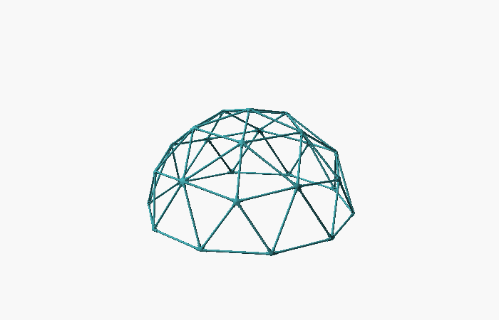
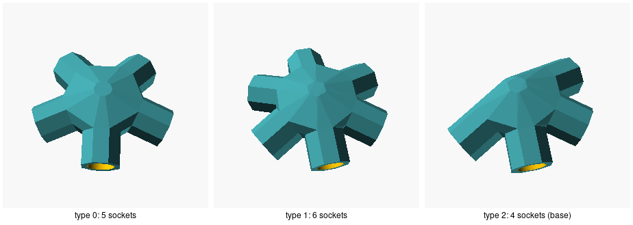

# geodesic-dome

Printable pipe hubs for building a geodesic dome, designed in OpenSCAD. Choose
the dome's frequency and radius and the pipe you'll use for struts. It works
out every hub's sockets from the real dome geometry, how many hubs and struts
of each kind you need, and what length to cut each strut.





## Use it

Open `geodesic_dome.scad` in [OpenSCAD](https://openscad.org) and set:

| Parameter | Default | Description |
| --- | --- | --- |
| `frequency` | 2 | How many times each icosahedron edge is divided. Even frequencies give a hemisphere. |
| `radius` | 1000 | Dome radius to the hub centres, in mm. |
| `inner_dia` | 20 | Bore that takes the strut. |
| `outer_dia` | 30 | Outside of each socket. |
| `length` | 25 | Socket depth along the strut. |
| `translate_out` | 0 | Where sockets start, from the hub centre. 0 works out the smallest distance that keeps neighbouring bores a full wall apart. |
| `outer_facets`, `inner_facets`, `roll_out` | 8, 64, 22.5 | Socket outside shape, bore smoothness, and the outside's twist. |
| `part` | `"layout"` | `"layout"` shows the whole dome; `"hub"` renders one hub type to print; `"none"` renders nothing, for including the file. |
| `hub_type` | 0 | Which hub type to render with `part = "hub"`. |

The console lists the schedule. For the defaults:

```
Dome: 2V, radius 1000 mm, 26 hubs, 65 struts
Sockets start 26.82 mm from each hub centre
Hub type 0: 6 needed, 5 sockets, elevations [-15.9, -15.9, -15.9, -15.9, -15.9] deg
Hub type 1: 10 needed, 6 sockets, elevations [-18, -18, -18, -18, -15.9, -15.9] deg
Hub type 2: 10 needed, 4 sockets, elevations [-18, -18, -18, -15.9] deg
Strut: 30 needed, chord factor 0.54653, centre to centre 546.5 mm, cut length 492.9 mm
Strut: 35 needed, chord factor 0.61803, centre to centre 618 mm, cut length 564.4 mm
```

`just schedule 3 1500` prints it for another frequency and radius without
opening OpenSCAD. Export each hub type with `part = "hub"`. It renders with
the dome's outward direction up, so every socket dips below horizontal by its
elevation: 31.7° at 1V, 15.9° to 18° at 2V, 10° to 11.9° at 3V and 7.3° to
9.3° at 4V.

### How the dome is built

The dome is an icosahedron with a vertex at the top, each face divided into a
triangular grid of the chosen frequency (a class I geodesic), with every grid
point pushed out to the sphere. Each hub has one socket per strut meeting it,
pointing straight along that strut. Hubs with the same socket angles count as
one type, mirror images included.

Even frequencies have a ring of vertices on the equator, so the base is flat.
Odd frequencies don't: the base takes the highest ring below the equator plus
any ring within 0.05 × radius below it. At 3V that gives the usual 5/8 dome,
whose base dips by 0.016 × radius between its two rings.

## Checks

`just test` takes about 70 s on OpenSCAD 2026.10.15. It checks:

- the subdivided sphere has 10F² + 2 vertices and 30F² edges at 1V to 4V;
- the 2V dome (26 hubs; 30 struts at 0.54653, 35 at 0.61803) and the 3V 5/8
  dome (61 hubs; 30 at 0.34862, 55 at 0.40355, 80 at 0.41241) match the
  published tables, and so do the 4V chord factors;
- at 2V and 3V, every hub placed on the dome: struts 0.5 mm thinner than the
  bore, cut to length, touch no hub, and struts 0.5 mm thicker hit every
  socket;
- every hub type at 2V to 4V is one piece, with 8-sided and round sockets;
- neighbouring bores keep at least one wall apart in every hub type at 1V to
  4V.

`just images` renders the pictures above.

## Not covered

Strut ends are cut square. The checks show each strut reaches its socket, but
nothing here models how a pipe end seats against the socket floor, or
fasteners. Hubs are printed parts: how strong they are depends on the
material and the print.

## Origin and licence

The hub design grew from the pipe-fitting hubs in
[3D part design with OpenSCAD 56: making geodesic dome hubs](https://infinityplays.com/3d-part-design-with-openscad-56-making-geodesic-dome-hubs-with-the-pipe-fitting-module/).
Its earlier versions, `connector_v1.scad` to `connector_v3.scad`, are in this
repository's history; none of their code or the tutorial's is in
`geodesic_dome.scad`. MIT; see [LICENSE](LICENSE).
